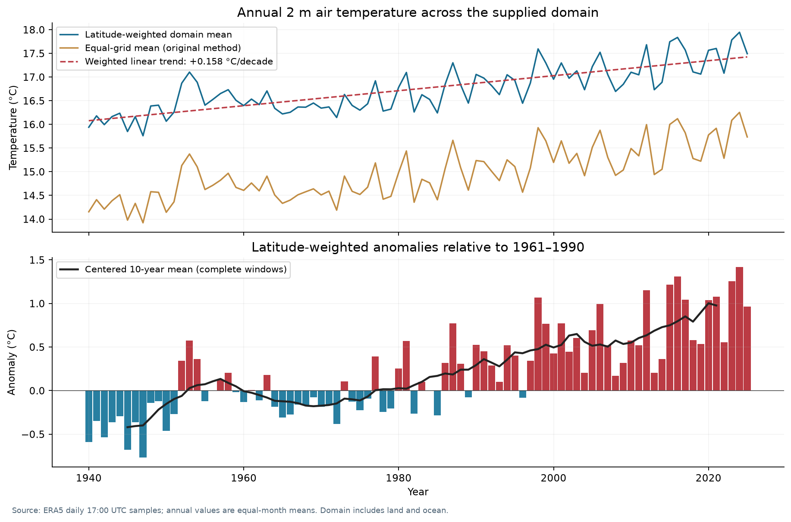
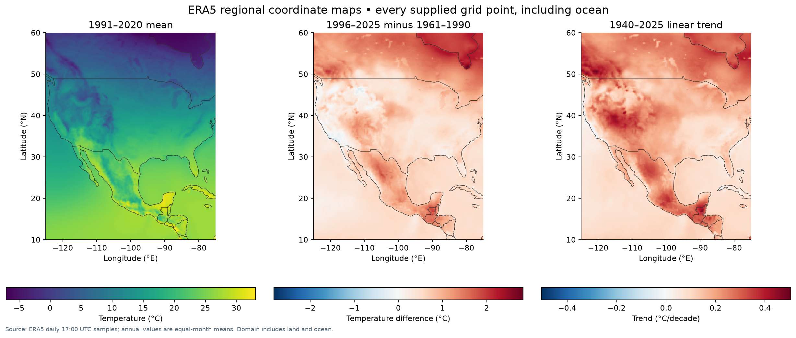
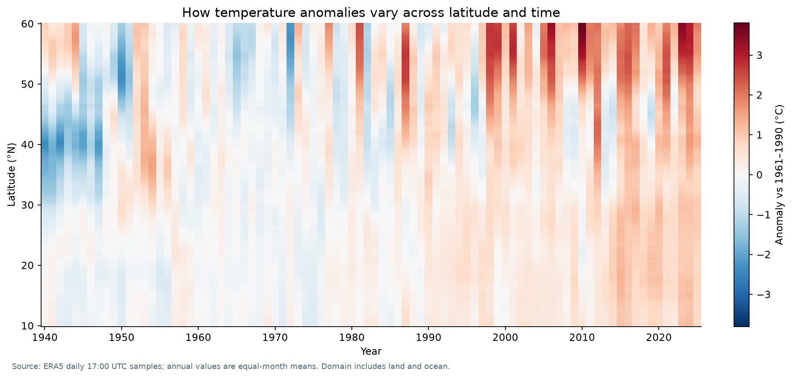

# ERA5 regional temperature data and maps

An Excel dataset, reproducible processing scripts, descriptive maps, and an
offline explorer for **2 m air temperature** across a regular regional grid.

| Property | Supplied data |
|---|---|
| Grid | 201 latitudes × 201 longitudes = **40,401 locations** |
| Extent | **10–60°N, 125–75°W**, including land and ocean |
| Grid spacing | 0.25° latitude and longitude |
| Monthly table | **1,042 months**, January 1940–October 2026 |
| Annual Excel | **86 years**, 1940–2025; 40,401 rows × 87 columns |
| Variable and units | ERA5 2 m air temperature, converted from K to °C |
| Source sampling | Once daily at **17:00 UTC**, January 1, 1940–October 21, 2026 |
| Missing cells | None in the supplied monthly temperature table |

**Interpretation:** these are monthly averages of once-daily 17:00 UTC
samples, followed by equal-month annual averages. They are not full-diurnal
monthly or annual air-temperature means. The GRIB header audit found 31,706
consecutive daily records at 17:00 UTC. **October 2026 ends on October 21 and
is partial.** See [the header audit](docs/grib_header_audit.json).

This is a regional rectangle, not a country or land-only average. The eastern
boundary is 75°W. The original download request was not supplied.
All annual comparisons and maps stop at the last complete calendar year, 2025.

## Start with the data

- [Original annual Excel workbook](data/annual/ERA5_Annual_Temperature_1940_2025.xlsx)
  is preserved byte for byte.
- [Monthly CSV shards](data/monthly/) contain the complete original monthly
  table, losslessly split into gzip files that are individually small enough
  for GitHub's browser upload. Each shard repeats the same column header.
- [Annual CSV](data/derived/annual_temperature.csv.gz) is a machine-readable
  alternative calculated from those monthly values.
- [Derived summaries](data/derived/) contain the plotted averages, anomalies,
  grid trends, latitude-by-year values, and city-to-grid matches.
- [Data dictionary](docs/DATA_DICTIONARY.md), [methods](docs/METHODOLOGY.md),
  and [provenance](docs/PROVENANCE.md) explain units, transformations, and limits.


## Understanding the averages, anomalies, and trends

The figures describe temperature across **latitude, longitude, and time**.
All spatial summaries include the supplied regional rectangle, covering
both land and ocean.

**Sampling:** the source contains one temperature sample per day at
**17:00 UTC**. Monthly values average those samples; annual values give
equal weight to the 12 monthly averages. These represent 17:00 UTC
conditions rather than averages across all hours of the day.
Annual figures use complete years from **1940 through 2025**.

### Annual temperatures

Let $T_{i,y,m}$ denote monthly temperature at location $i$, in year $y$
and calendar month $m$. Annual temperature is

```math
T_{i,y}=\frac{1}{12}\sum_{m=1}^{12}T_{i,y,m}.
```

All 12 months are required. Months receive equal weight regardless of
their number of days.

### Equal-grid and latitude-weighted averages

The equal-grid average gives each of the 40,401 locations the same weight:

```math
\overline{T}^{\,\mathrm{equal}}_y
=\frac{1}{N}\sum_{i=1}^{N}T_{i,y},
\qquad N=40{,}401.
```

The latitude-weighted average uses weights proportional to the cosine
of latitude:

```math
\overline{T}^{\,\mathrm{weighted}}_y
=\frac{\sum_{i=1}^{N}w_iT_{i,y}}{\sum_{i=1}^{N}w_i},
\qquad w_i=\cos(\phi_i).
```

Here, $\phi_i$ is latitude expressed in radians.

Grid cells on a regular latitude–longitude grid become smaller toward
the poles. Cosine weighting therefore approximates an area average,
giving relatively less weight to northern locations. This explains why
the two averages can have different temperature levels and slopes.

### What is a temperature anomaly?

An anomaly is a **difference from a reference-period average**.
It does not mean a measurement error or necessarily an unusual event.

The reference temperature at each location is its 1961–1990 average:

```math
B_i=\frac{1}{30}\sum_{y=1961}^{1990}T_{i,y}.
```

The annual anomaly is

```math
A_{i,y}=T_{i,y}-B_i.
```

An anomaly of **+1.0 °C** means the year was 1.0 °C warmer than that
location's 1961–1990 average. An anomaly of **−1.0 °C** means it was
1.0 °C cooler.

The domain anomaly chart uses the latitude-weighted average of these
location anomalies:

```math
\overline{A}_y
=\frac{\sum_i w_iA_{i,y}}{\sum_i w_i}.
```

Red bars show positive anomalies; blue bars show negative anomalies.
The black curve is a **centered 10-year rolling average**, displayed
only where all 10 annual values are available. It makes slower changes
easier to distinguish from year-to-year variation.

Changing the reference period shifts the anomaly zero point but does
not change the linear slope of the same complete temperature series.

### How is the linear trend calculated?

For an annual temperature series $Z_y$, the fitted straight line is

```math
\widehat{Z}_y=\alpha+\beta(y-\bar{y}).
```

Its intercept and slope are

```math
\alpha=\bar{Z},
\qquad
\beta=
\frac{\sum_y(y-\bar{y})(Z_y-\bar{Z})}
     {\sum_y(y-\bar{y})^2}.
```

Here, $\bar{y}$ is the average year and $\bar{Z}$ is the average
temperature over 1940–2025. The series $Z_y$ can represent either
a domain average or one grid location.

The slope $\beta$ has units of °C/year. Multiplying it by 10 gives
the trend in **°C/decade**:

```math
\mathrm{Trend}=10\beta.
```

The plotted domain trend of approximately **+0.158 °C/decade** describes
the increase along the fitted line. Individual years and decades can
depart substantially from that line.

These slopes summarize the selected record. They are not forecasts
or tests of statistical significance.

### What do the geographic maps show?

**Mean temperature, 1991–2020**

The first map shows the average of 30 annual temperatures at each location:

```math
C_i=\frac{1}{30}\sum_{y=1991}^{2020}T_{i,y}.
```

Its colors represent temperature in °C.

**Change between two 30-year periods**

The second map subtracts the 1961–1990 mean from the 1996–2025 mean:

```math
\Delta_i=
\frac{1}{30}\sum_{y=1996}^{2025}T_{i,y}
-\frac{1}{30}\sum_{y=1961}^{1990}T_{i,y}.
```

Positive values indicate warmer conditions in the later period.
This is a **temperature difference in °C**, not a rate.

**Linear trend, 1940–2025**

The third map fits the trend equation separately at every grid location.
Its colors represent **°C/decade**, showing how the fitted rate of change
varies geographically.

### How do the heatmaps show multiple dimensions?

The **latitude–year heatmap** averages annual anomalies across longitude
within each latitude band:

```math
H_{\phi,y}
=\frac{1}{N_\phi}\sum_{i:\,\phi_i=\phi}A_{i,y}.
```

Here, $N_\phi$ is the number of longitude points in that band.
The horizontal axis shows year, the vertical axis shows latitude,
and color shows the anomaly in °C. This reveals differences between
latitude bands that an overall domain average can hide.

The **calendar-month–year heatmap** preserves season and year.
Each monthly domain temperature is compared with the 1961–1990 average
for the **same calendar month**. January is compared with January, for
example, removing the usual seasonal cycle from the anomaly calculation.

## Visualizations



The original equal-grid spatial average is shown alongside a cosine-latitude
weighted average. Both use the supplied rectangle and include ocean cells.



These maps show 1991–2020 mean temperature, a change between two 30-year
periods, and a linear slope at every grid location. Natural Earth outlines
provide geographic context. All maps retain the full supplied domain.



The latitude-by-year diagram exposes spatial differences hidden by an overall
average. Additional figures show [seasonality](figures/04_seasonality.png) and
[selected city-near locations](figures/05_city_comparison.png). Every figure
is supplied as PNG and SVG.

**Interactive:** download this folder and open [explorer.html](explorer.html)
in a browser. Choose a year and map layer, then click a location or enter its
coordinates. All 40,401 annual location series are embedded. No internet or
server is needed. GitHub's repository file view displays HTML source; open
the downloaded file locally to interact with it.

The dataset has one temperature variable with three coordinates: latitude,
longitude, and time. Flattening the 201 × 201 grid produces a multivariate
annual matrix with 86 observations and 40,401 location variables when
transposed. These locations are spatially correlated, not independent
measurements of 40,401 different physical quantities.

## Reproduce the descriptive outputs

Python 3.11 or 3.12 is recommended. From this folder:

```bash
python -m venv .venv
source .venv/bin/activate
python -m pip install -r requirements.txt
python scripts/analyze.py
python scripts/validate.py
python scripts/checksums.py
```

Windows activation: `.venv\Scripts\activate`.

`analyze.py` verifies shard checksums and regenerates derived tables, five
figure pairs, `explorer.html`, and `docs/data_summary.json`. It preserves the
supplied Excel file. `validate.py` independently compares every annual Excel
value with a 12-month mean from the monthly table and records its results.
See [the validation report](docs/validation.json) and
[the tested environment](docs/TESTED_ENVIRONMENT.md).
`checksums.py` verifies the delivered file inventory. After intentionally
regenerating or editing files, use `python scripts/checksums.py --write` to
record the new versions.

### Recover the original monthly CSV

```bash
python scripts/package_monthly.py restore data/monthly work/ERA5_monthly_t2m.csv
```

The restored file's SHA-256 must match `data/monthly/manifest.json`. This is
a byte-for-byte reconstruction, including original numeric formatting and
row order. For normal analysis there is no need to restore it first.

### Original processing and plotting code

The four original data scripts are preserved under [scripts/original](scripts/original/).
They expect input files in the current working directory:

```bash
mkdir -p work
python scripts/package_monthly.py restore data/monthly work/ERA5_monthly_t2m.csv
cd work
python ../scripts/original/Annual_1940_2025_data.py
python ../scripts/original/Overall_average_trend.py
python ../scripts/original/Plotting_City_based_surface_temperatures.py
```

The first command recreates the annual workbook in `work/`. It requires all
12 months per annual value. The original plotting scripts have different
averaging and completeness settings from the new figures; see methods.

For the earlier GRIB → monthly CSV step, place the original `ERA5.grib` in
`work/`, install `requirements-grib.txt`, and from `work/` run:

```bash
python ../scripts/original/Data_Processing_Excel.py
```

The 2.57 GB raw GRIB is deliberately outside this upload folder. Its size,
hash, and acquisition limitations are documented in provenance. The packaged
monthly table is sufficient to regenerate all included descriptive outputs.

## Upload to GitHub

1. Create an empty repository with a name such as `era5-regional-temperature`.
2. Upload **the contents of this folder**, keeping subfolders intact. Upload
   in batches if needed. The accompanying ZIP is for transport: unzip it
   before uploading, so the README and figures display normally.
3. The Excel workbook is just under GitHub's 25 MiB browser-upload limit.
   Every packaged file is checked against that limit. The uncompressed
   monthly CSV and raw GRIB are excluded from normal Git tracking.

Git users can instead run:

```bash
git init
git add .
git commit -m "Add ERA5 regional data, processing code, and descriptive maps"
git branch -M main
git remote add origin https://github.com/YOUR-USERNAME/YOUR-REPOSITORY.git
git push -u origin main
```

GitHub documents its [file-size limits here](https://docs.github.com/en/repositories/working-with-files/managing-large-files/about-large-files-on-github).
No repository URL or publication is assumed by this package.

## Source and licensing

Source: ECMWF / Copernicus Climate Change Service (C3S), ERA5. Official
[ERA5 documentation](https://confluence.ecmwf.int/pages/viewpage.action?pageId=414588701)
and the [CDS hourly single-level catalogue](https://cds.climate.copernicus.eu/datasets/reanalysis-era5-single-levels?tab=overview).
The exact original retrieval request remains unverified; the supplied GRIB's
daily 17:00 UTC sampling is established by its headers.

Code and documentation: [MIT](LICENSE). ERA5-derived data and figures:
[CC BY 4.0 with source attribution](DATA_LICENSE.md). Natural Earth map layers:
public domain. See [citation guidance](docs/CITATION.md) for source references.
